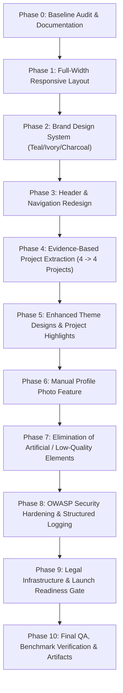

# Portify AI — Strategic Refactoring & Engineering Upgrade Plan

**Architectural Blueprint**: Principal Software Architect & Senior Engineering Team  
**Execution Target**: Production-grade refactoring with zero downtime, zero regressions, and full backwards compatibility.

---

## 1. Architectural Strategy & Phased Roadmap



---

## 2. Phase-by-Phase Technical Specifications

### Phase 1: Full Viewport Width & Responsive Layout Architecture
- **Objective**: Eliminate restrictive `max-w-7xl`, `max-w-6xl`, and `max-w-4xl` wrappers in dashboard, studio, and generated themes.
- **Approach**:
  - Update `Container.jsx` to default to fluid widths with responsive horizontal gutters (`px-4 sm:px-6 lg:px-12 xl:px-16`).
  - Redesign `DashboardPage.jsx` into a full-width desktop layout: responsive metrics ribbon, expanded portfolio grid, fluid action headers.
  - Upgrade all 5 themes (`MinimalPro`, `DarkDeveloper`, `CreativeGradient`, `CorporateElite`, `ModernGlass`) to span full desktop viewports while preserving optimal typographic line-lengths (`max-w-prose` / `max-w-3xl` for narrative paragraphs).
  - Verify zero horizontal scrolling across viewports: $375\text{px}$, $768\text{px}$, $1024\text{px}$, $1366\text{px}$, $1440\text{px}$, $1920\text{px}$.

### Phase 2: Official Brand Design System
- **Palette Tokens**:
  - **Primary**: Deep Teal (`#176B67`) — Primary actions, active navigation, feature indicators, key highlights.
  - **Surface/Background**: Soft Ivory (`#F7F5EF`) — Application background, card surfaces, clean canvas.
  - **Typography & Content**: Deep Charcoal (`#252B2A`) — Headings, body text, primary interface labels.
- **Rules**:
  - Purge all purple/indigo gradients (`from-indigo-600 to-violet-600`), neon highlights, and pill button styles.
  - Configure Tailwind tokens in `client/tailwind.config.js` and `client/src/index.css`.
  - Ensure generated portfolio themes maintain independent identities; do not enforce the Portify AI brand palette onto users' portfolios.

### Phase 3: Header & Navigation Redesign
- **Layout Specification**:
  - Spans 100% of available viewport width with subtle bottom border (`border-[#252B2A]/10`).
  - Left group: Authentic Portify AI brand mark and typography.
  - Center/Nav group: Accessible, well-spaced links (`Overview`, `Dashboard`, `Upload Resume`).
  - Right group: Account status, profile actions, sign-in/register buttons.
  - Mobile: Clean, accessible mobile hamburger drawer without visual clutter.

### Phase 4: Advanced Evidence-Based Project Extraction Engine
- **Dedicated Project Extraction Service (`server/src/services/projectExtractionService.js`)**:
  - Explicit project boundary recognition: title lines, date stamps, role headers, bullet highlights.
  - Sentence-splitting prevention: multi-line descriptions remain attached to the parent project rather than spawning artificial entries.
  - Semantic and exact deduplication: merged mentions across summary, experience, and projects.
  - Evidence-based data contract:
    ```typescript
    interface ProjectEvidence {
      title: string;
      description: string;
      technologies: string[];
      dates?: string;
      sourceEvidence: string[];
      sourcePages?: number[];
      confidence: number;
      verificationStatus: 'verified' | 'inferred' | 'pending';
    }
    ```
- **Accuracy Benchmark**:
  - Evaluate against a local dataset of 8 diverse resumes (single-column, two-column, multi-page, 4-project resumes, scanned, etc.).
  - Target: $\ge 90\%$ Precision, Recall, and Project Count Accuracy. Document results in `RESUME_EVALUATION_REPORT.md`.

### Phase 5: Generated Portfolio Design Polish
- **Enhancements across all 5 Themes**:
  - Elevate project showcases into the visual centerpiece of technical portfolios.
  - Add refined metadata tags, live demo / repository badges, structured technology chips, and clean responsive grids.
  - Modernize typography hierarchies, subtle borders, and generous whitespace.

### Phase 6: Optional Profile Photo Feature
- **Capabilities**:
  - Add optional profile photo upload to Resume Editor / Personal Info.
  - Support manual file upload, real-time avatar preview, replacement, and removal.
  - Defensive security: validate binary image signatures (JPEG, PNG, WebP), enforce 5MB size limit, strip EXIF metadata, store securely.
  - Resilient UI: gracefully format themes when no avatar is provided without looking incomplete.

### Phase 7: Removal of Artificial & Low-Quality Design Elements
- **Cleanup Checklist**:
  - Remove fake testimonials, fake user numbers, and fabricated metric claims.
  - Eliminate generic purple gradients and floating decorative shapes.
  - Replace vague copy with concise, professional engineering descriptions.
  - Remove "Made with AI" tags and superfluous badges.

### Phase 8: Application Security Hardening (OWASP Top 10 & ASVS 5.0)
- **Security Upgrades**:
  - Enforce schema boundaries: add `.max(50)` constraints on all Zod collections to prevent memory exhaustion (GHSA-mrhx-c7xc-m3w5).
  - Enforce strict ownership verification on all portfolio mutations and reads.
  - Implement structured logging with sanitized diagnostics (zero PII, passwords, or full resumes).
  - Configure Helmet security headers, CSP rules, strict CORS, and rate limiting.

### Phase 9: Legal Infrastructure & Launch Gate
- **Deliverables**:
  - Route `/privacy` with comprehensive, authentic Privacy Policy.
  - Route `/terms` with authentic Terms and Conditions.
  - Connect legal links in global footer.
  - Replace default favicon with brand icon.
  - Create `LAUNCH_READINESS.md` checklist with transparent evaluation of external launch prerequisites.

### Phase 10: Final Quality Assurance & Verification
- **Test Execution**:
  - Run ESLint, unit tests, integration tests, Playwright E2E suites across $375\text{px}$ to $1920\text{px}$ viewports.
  - Generate final reports: `FINAL_QA_REPORT.md`, `SECURITY_TEST_REPORT.md`, `RESUME_EVALUATION_REPORT.md`, `LAUNCH_READINESS.md`.

