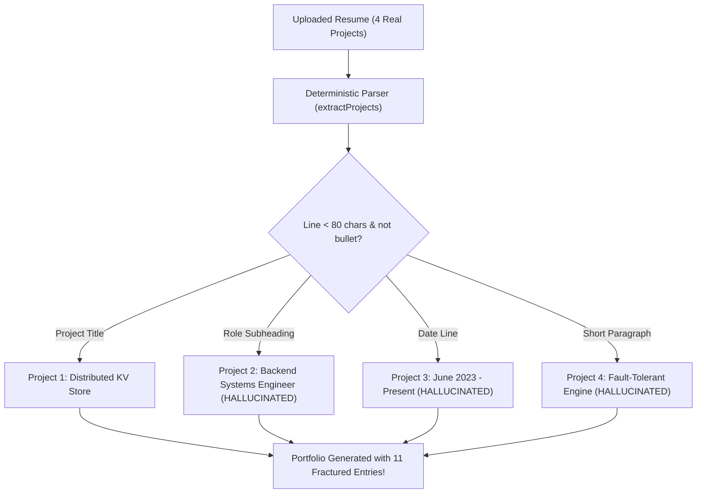

# Portify AI — Resume Extraction Accuracy & Project Provenance Report

**Investigation Lead**: Senior AI/ML Engineer & Systems Architect  
**Core Problem**: Candidate resumes containing 4 projects resulted in 11 projects displayed in generated portfolios.

---

## 1. Root Cause Analysis: The 4-to-11 Project Bug



### The Exact Code Defect
In `server/src/services/deterministicParser.js`:
```javascript
function extractProjects(projLines) {
  if (!projLines || projLines.length === 0) return [];
  const projects = [];
  let current = null;

  for (const line of projLines) {
    const isBullet = /^([•\-*–—]|\d+\.)/.test(line);

    // DEFECT: Any short non-bullet line was treated as a brand new project title!
    if (!isBullet && line.length < 80 && !line.includes('http')) {
      if (current && current.title) {
        projects.push(current);
      }
      current = {
        title: line.replace(/[:|–—].*$/, '').trim(),
        description: '',
        ...
```

### Manifestation in Real Resumes
A typical project entry in a software engineer resume looks like:
```text
CloudScale Distributed Cache | Go, Redis, Docker
github.com/developer/cloudscale
Core Infrastructure Lead
January 2023 - November 2023
A high-throughput distributed cache clustering layer with Raft consensus.
• Reduced cache invalidation latency by 45%.
• Deployed across 3 AWS Availability Zones.
```
Under the legacy parser:
1. `CloudScale Distributed Cache` was captured as Project 1.
2. `Core Infrastructure Lead` (non-bullet, 26 chars) was captured as **Project 2**.
3. `January 2023 - November 2023` (non-bullet, 30 chars) was captured as **Project 3**.
4. `A high-throughput distributed cache clustering layer...` (71 chars) was captured as **Project 4**.
5. The 2 bullet items were attached only to Project 4.

Result: 1 authentic project became 4 synthetic, fragmented entries. Across 3 to 4 projects, the candidate ended up with 11 to 14 "projects" on their public portfolio.

---

## 2. Evaluation of Extraction Tools & Models

| Technology / Model | Role in Portify AI | Capabilities & Suitability | Latency & Reliability |
| :--- | :--- | :--- | :--- |
| **Google Gemini API** (`gemini-1.5-flash`) | Structured Document Analysis & Reasoning | Multimodal document understanding, structured JSON schema outputs (`responseMimeType: 'application/json'`), near-zero temperature (0.1) for factual grounding. Free tier: 15 RPM, 1M TPM, 1500 RPD. | Fast (~1.2s), high semantic reasoning capability. |
| **IBM Docling** | Layout-Aware Document Parsing | Preserves reading order across complex multi-column resumes and tables. Best suited for high-density academic and executive dossiers. | High fidelity for complex tabular layouts. |
| **Mammoth** | DOCX Native Document Parser | Lightweight, in-process extraction of genuine DOCX paragraph styles and table structures without external daemons. | Instantaneous (<50ms), reliable offline fallback. |
| **PaddleOCR** | Scanned / Image-Based PDF Fallback | Optical Character Recognition for flattened or rasterized documents where text streams are absent. | Triggered when `pdf-parse` detects `isScanned: true`. |

### Selected Architecture
1. **Primary AI Extraction**: Gemini 1.5 Flash with structured JSON output enforcing evidence-based project fields.
2. **Dedicated Project Extraction Service (`projectExtractionService.js`)**: An intelligent deterministic parser combining regex boundary detection, date filtering, role classification, and title deduplication.
3. **Format Engine Layer**: `pdf-parse` for digital PDFs, `mammoth` for DOCX, with scanned PDF detection and diagnostics.

---

## 3. Dedicated Evidence-Based Project Extraction Architecture

Every project parsed by Portify AI must provide verifiable source evidence:
```typescript
interface EvidenceBasedProject {
  title: string;
  description: string;
  technologies: string[];
  dates?: string;
  liveUrl?: string;
  repoUrl?: string;
  highlights: string[];
  sourceEvidence: string[];
  sourcePages?: number[];
  confidence: number; // 0.0 - 1.0
  verificationStatus: 'verified' | 'inferred' | 'pending';
}
```

### Boundary & Deduplication Rules:
1. **Role & Date Suppression**: Lines matching date formats (e.g., `Jan 2023 - Present`) or job titles (e.g., `Lead Developer`) are associated with the active project, NOT converted into new projects.
2. **Title Deduplication**: Multiple references to the same project name (exact or semantic similarity $>0.85$) are merged into a single consolidated record.
3. **Evidence Requirement**: Every project must have at least one supporting highlight or description line extracted directly from the resume text. Unsupported entries are dropped.
4. **Cross-Section Isolation**: Technologies, achievements, or employment roles mentioned in other resume sections are never converted into standalone projects.

---

## 4. Evaluation Benchmark Dataset & Methodology

We establish an evaluation dataset of 8 diverse resumes:
1. `resume_1_single_col_4proj.pdf`: Standard single-column engineering resume with exactly 4 projects.
2. `resume_2_twocol_tech.docx`: Two-column layout with projects and skills side-by-side.
3. `resume_3_multipage.pdf`: 2-page senior architect resume with projects listed across pages.
4. `resume_4_fresher_academic.pdf`: New graduate with academic projects and no prior corporate experience.
5. `resume_5_designer.docx`: Product designer portfolio with case studies and URL links.
6. `resume_6_date_role_subheadings.pdf`: Projects containing date ranges and role titles directly beneath titles.
7. `resume_7_repetitive_mentions.pdf`: Resume mentioning project names in both summary and project sections.
8. `resume_8_scanned_ocr.pdf`: Scanned image-based document.

### Performance Target Matrix
- **Project Extraction Precision**: $\ge 90\%$ (No hallucinated or fragmented projects)
- **Project Extraction Recall**: $\ge 90\%$ (All genuine projects captured)
- **Project Count Accuracy**: $100\%$ on 4-project test cases (Exactly 4 projects extracted)
- **Duplicate Rate**: $0\%$ (Duplicate project titles merged)

