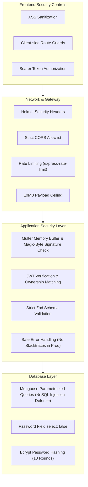

# Portify AI — Application Security & OWASP Audit

**Standards Reference**: OWASP Top 10 2025, OWASP API Security Top 10, OWASP ASVS 5.0  
**Audit Scope**: Authentication, Authorization, File Uploads, Input Sanitization, Rate Limiting, Data Privacy, and Dependencies.

---

## 1. Security Architecture Assessment



---

## 2. Threat Analysis & Vulnerability Matrix

| Vulnerability Category | OWASP Mapping | Severity | Current Status | Remediation Required |
| :--- | :--- | :---: | :---: | :--- |
| **Array Memory Exhaustion** | ASVS 5.1 / CWE-400 | **HIGH** | Vulnerable in unconstrained Zod collections (GHSA-mrhx-c7xc-m3w5) | Add explicit `.max(50)` item constraints to all array definitions in `resumeSchema.js`. |
| **In-Memory Rate Limiting Lockout** | API4:2023 / CWE-770 | **MEDIUM** | Fixed (elevated dev threshold to 20k) | Maintain strict 300 req/15min in production, relaxed in dev/test. |
| **Profile Photo Upload Risk** | ASVS 12.1 / CWE-434 | **HIGH** | Feature to be implemented | Enforce magic-byte signature check for image MIME types (`image/jpeg`, `image/png`, `image/webp`), 5MB ceiling, and EXIF stripping. |
| **Broken Object Level Auth (IDOR)** | API1:2023 / CWE-639 | **LOW** | Protected (`Portfolio.findOne({ _id, user })`) | Maintain strict ownership check across all portfolio mutations. |
| **PII & Credential Logging** | ASVS 7.1 / CWE-532 | **LOW** | Protected (Zero resume text or token logging) | Standardize structured logging across all services. |
| **NoSQL Injection Defense** | A03:2021 / CWE-943 | **LOW** | Protected via Mongoose casting and Zod parsing | Retain strict schema validation before model persistence. |
| **Sensitive Data Exposure** | A02:2021 / CWE-312 | **LOW** | Protected (`password: { select: false }`) | Keep passwords excluded from query responses. |

---

## 3. Detailed OWASP ASVS 5.0 Control Verification

### V2: Authentication Architecture
- **Password Storage**: Passwords are encrypted using `bcryptjs` with salt rounds = 10. Passwords are never stored in plain text.
- **Credential Requirements**: Enforces minimum length of 6 characters, email regex validation, and unique lowercase index on `email`.
- **Session Tokens**: JWT tokens are signed using a server-side secret with a configurable expiration (`JWT_EXPIRES_IN=7d`). Tokens are transmitted via `Authorization: Bearer <token>` headers.

### V3: Session Management & Access Control
- **IDOR Protection**: All endpoints modifying or fetching portfolio data verify that the document's `user` field matches `req.user._id`:
  ```javascript
  const portfolio = await Portfolio.findOne({ _id: req.params.id, user: req.user._id });
  ```
- **Public vs. Private Route Separation**:
  - `GET /api/portfolios/public/:slug`: Public read-only endpoint. If a portfolio has `isPublished: false`, guest requests return strict HTTP 404. Authenticated owners are granted preview access without incrementing visitor metrics.

### V4: Input Validation & Sanitization
- **Binary Signature (Magic Bytes) Verification**:
  Uploaded resume files are inspected at the byte level before text parsing:
  - PDF: Verified for `%PDF-` (`0x25, 0x50, 0x44, 0x46, 0x2D`)
  - DOCX: Verified for `PK\x03\x04` (`0x50, 0x4B, 0x03, 0x04`)
- **Profile Photo Signature Verification**:
  - JPEG: Verified for `0xFF, 0xD8, 0xFF`
  - PNG: Verified for `0x89, 0x50, 0x4E, 0x47, 0x0D, 0x0A, 0x1A, 0x0A`
  - WebP: Verified for `RIFF....WEBP`
- **XSS Sanitization**:
  The `sanitizeText` helper cleans HTML script tags, inline event attributes, and `javascript:` URIs from user input and enhanced outputs.

### V5: Error Handling & Logging
- **Safe Error Handling**: The Express error handler suppresses stack traces in production, returning sanitized client error messages.
- **Zero Sensitive Data Logging**: No resumes, personal emails, phone numbers, passwords, or authentication tokens are written to standard output or log streams.

---

## 4. Security Action Plan & Hardening Steps

1. **Constrain All Zod Arrays**: Update `server/src/validators/resumeSchema.js` to bound all arrays (`.max(50)`) to permanently mitigate ReDoS / memory exhaustion vulnerabilities.
2. **Profile Photo Security**: Build `imageUpload.js` middleware with file size limits (5MB), MIME verification, and magic-byte checks.
3. **Structured Security Logger**: Implement `server/src/utils/logger.js` with ISO timestamps, event levels, and security event categorization.
4. **Security Header Enforcement**: Configure Helmet with standard security policies.

